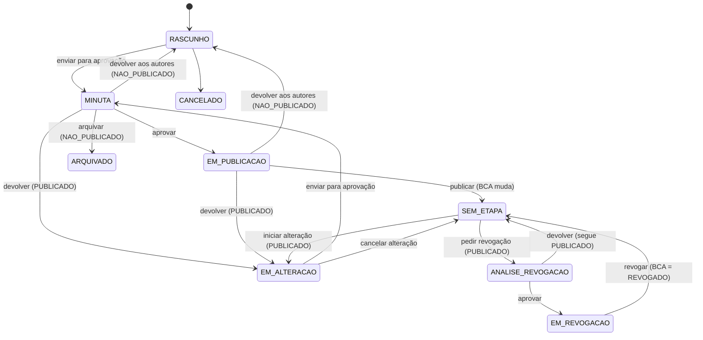
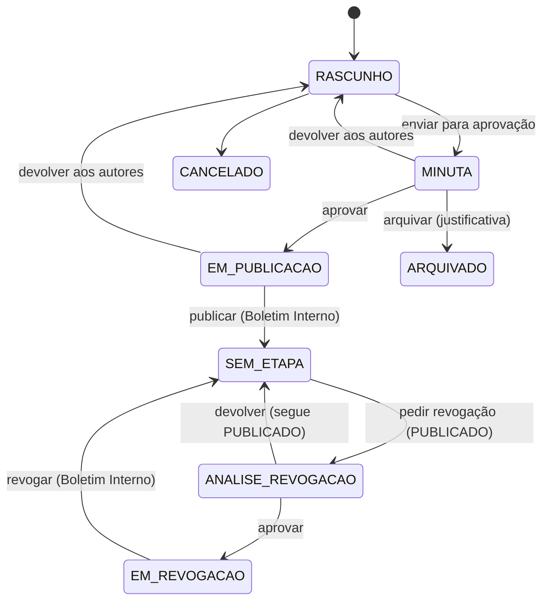

# Ciclo de Vida do Documento

A situação de um documento é **duas coisas independentes**, e nunca uma só:

| | Situação BCA | Situação Local |
|---|---|---|
| **O que é** | A situação **real**: espelha o repositório oficial (o BCA) | A **etapa interna** em curso no sistema (elaboração, aprovação, alteração...) — não existe na vida real |
| **Valores** | `NAO_PUBLICADO` · `PUBLICADO` · `REVOGADO` | `RASCUNHO` · `MINUTA` · `EM_PUBLICACAO` · `EM_ALTERACAO` · `ANALISE_REVOGACAO` · `EM_REVOGACAO` · `CANCELADO` · `ARQUIVADO` · `SEM_ETAPA` |
| **Quando muda** | **Só** ao registrar portaria + BCA (publicar → `PUBLICADO`; revogar → `REVOGADO`) | A cada passo do fluxo. Só **uma etapa local por vez**; `SEM_ETAPA` = nenhuma em curso |
| **Na tela** | Chip principal | Chip secundário (só aparece quando há etapa em curso) |

O motivo da separação: um ato oficialmente **publicado** não deixa de estar publicado só porque alguém abriu uma alteração ou pediu a análise de uma revogação. O sistema nunca mostra apenas "Em Alteração" quando, oficialmente, o documento é `PUBLICADO` — a situação BCA é sempre visível.

Combinações que existem (`SituacaoLocalEnum` documenta as mesmas):

| Situação BCA | Situações locais possíveis |
|---|---|
| `NAO_PUBLICADO` | `RASCUNHO`, `MINUTA`, `EM_PUBLICACAO`, `CANCELADO`, `ARQUIVADO` |
| `PUBLICADO` | `SEM_ETAPA`, `EM_ALTERACAO`, `MINUTA`, `EM_PUBLICACAO`, `ANALISE_REVOGACAO`, `EM_REVOGACAO` |
| `REVOGADO` | `SEM_ETAPA` |

**O que cada etapa de elaboração significa:**

- **`RASCUNHO`** é o documento **em elaboração**: o autor e os coautores o editam à vontade, e **editar não muda a etapa** (nem anexar uma imagem). É a única etapa em que o documento pode ser **cancelado** ou **excluído**.
- **`MINUTA`** é o documento **em aprovação ou em conferência**: ele só vira Minuta quando é **enviado para aprovação** (ninguém é escolhido: qualquer Aprovador da OM do documento age). Na Minuta **quem edita é quem aprova** — nem o autor edita. A autoridade **aprova** (`EM_PUBLICACAO`), **devolve aos autores** (volta a `RASCUNHO`) ou **arquiva** (`ARQUIVADO`).
- **`ARQUIVADO`** é o fim de uma Minuta que a autoridade decidiu não levar adiante: exige uma **justificativa**, que fica registrada no documento com **quem arquivou** e **quando**. Só se arquiva um documento que nunca foi publicado (uma alteração de ato publicado se aprova ou se devolve).

Por isso, para **excluir** um documento que já foi para aprovação, a autoridade primeiro o **devolve aos autores** (volta a `RASCUNHO`); excluir e cancelar só valem em `RASCUNHO`.

> **NPA:** a [NPA](dominio.md#npa--norma-padrão-de-ação) percorre o mesmo caminho de elaboração, aprovação, publicação e revogação (e as mesmas regras de `RASCUNHO`, `MINUTA` e `ARQUIVADO`), mas **sem alteração** — o fluxo completo está em [Fluxo da NPA](#fluxo-da-npa-norma-padrão-de-ação).

> **Documentos anteriores a esta regra.** Antes, a `MINUTA` era um passo de organização (o documento virava minuta na primeira edição, no primeiro anexo ou por um botão) e a aprovação era a etapa `EM_REVISAO`. A migração (hoje consolidada na `V1__initial.sql`, na seção "origem: V2__minuta_e_arquivamento.sql") converteu os documentos que já existiam: os que estavam em `MINUTA` (nunca enviados) voltaram a `RASCUNHO`, e os que estavam em `EM_REVISAO` passaram a `MINUTA`; `dt_minuta` passou a ser a data do envio para aprovação (o que era `dt_em_revisao`, coluna removida), e o histórico foi convertido do mesmo jeito. Ela acrescenta as colunas do arquivamento (`dt_arquivamento`, `tx_justificativa_arquivamento`, `arquivador_id`).

## Transições da Situação Local

Validadas no servidor por `DocumentoStatusService.changeStatus()` — tentativas inválidas resultam em `StatusCannotBeUpdatedException` (`403`, "Transição não permitida: X → Y (situação BCA: Z)."). O pedido (`PATCH /v1/documentos/{id}/status`) sempre informa a **nova situação local** (`situacaoLocal`); `SEM_ETAPA` como destino significa **concluir a etapa em curso** — o que isso quer dizer depende da origem (tabela abaixo).

| Origem → destino pedido | Ação | Efeito na Situação BCA |
|---|---|---|
| `RASCUNHO/EM_ALTERACAO → MINUTA` | **enviar para aprovação** (ninguém é escolhido) — a única entrada na Minuta | — |
| `RASCUNHO → CANCELADO` | cancelar o documento (só o rascunho) | — |
| `MINUTA → EM_PUBLICACAO` | aprovar (qualquer aprovador da OM) — congela a versão em tramitação | — |
| `MINUTA/EM_PUBLICACAO → RASCUNHO` (`NAO_PUBLICADO`) ou `→ EM_ALTERACAO` (`PUBLICADO`) | **devolver aos autores** | — (nunca tira um documento publicado de `PUBLICADO`) |
| `MINUTA → ARQUIVADO` | **arquivar** (só `NAO_PUBLICADO`; exige a **justificativa**, enviada em `justificativa` no pedido) | — |
| `EM_PUBLICACAO → SEM_ETAPA` | **publicar** (portaria + BCA) | `NAO_PUBLICADO → PUBLICADO` (1ª publicação); segue `PUBLICADO` numa alteração |
| `SEM_ETAPA → EM_ALTERACAO` | iniciar alteração (só `PUBLICADO`) | — |
| `EM_ALTERACAO → SEM_ETAPA` | **cancelar alteração** — só sem alterações pendentes (desfeitas antes, elemento a elemento) | — (segue `PUBLICADO`) |
| `SEM_ETAPA → ANALISE_REVOGACAO` | pedir revogação (só `PUBLICADO`; vai a qualquer aprovador da OM) | — |
| `ANALISE_REVOGACAO → EM_REVOGACAO` | aprovar a revogação (qualquer aprovador da OM) | — |
| `ANALISE_REVOGACAO → SEM_ETAPA` | devolver a análise — não exige nada | — (segue `PUBLICADO`) |
| `EM_REVOGACAO → SEM_ETAPA` | **revogar** (portaria + BCA) — a única saída de `EM_REVOGACAO` | `PUBLICADO → REVOGADO` |

**Não há revogação durante uma alteração** (`EM_ALTERACAO → ANALISE_REVOGACAO` não existe): primeiro conclui-se ou cancela-se a alteração. E **`EM_REVOGACAO` nunca volta a `PUBLICADO`** — não há para onde devolver.

**Sem atribuição pessoal — cada transição tem um dono por papel e OM:** ninguém é escolhido ao enviar nem ao aprovar. *Quem* pode fazer cada transição (aprovador da OM do documento, publicador da fila da espécie, autor/coautor) e quem pode editar em cada etapa estão em [Papéis e Permissões](papeis-e-permissoes.md#quem-faz-cada-transição). Quem pode agir agora é notificado (ver [Autenticação e Colaboração](autenticacao.md#notificações-e-auditoria)).

Devolver (ou enviar de novo) recomeça sem aprovador nem publicador; pedir a revogação, aprová-la ou recusá-la **não** mexe em quem aprovou o texto.

**Regra de imutabilidade:** o conteúdo textual só pode ser alterado em `RASCUNHO` (pelos autores, edição livre), em `MINUTA` (por quem aprova, e só de documento ainda não publicado) ou em `EM_ALTERACAO` (só por emenda, elemento a elemento). Os **anexos** de imagem seguem a mesma regra de edição do resto do documento (`podeEditar`, acima): adicionar ou remover anexo só é permitido a quem pode editar o documento naquela etapa, e de `EM_PUBLICACAO` em diante o anexo também está congelado (`403`); o `AnexoService` ainda confere a etapa (`SituacaoLocalEnum.aceitaEdicao`) como segunda barreira. O salvamento em massa é rejeitado para qualquer documento `PUBLICADO`. Para criar uma revisão totalmente nova, use a **clonagem**, que gera um novo documento em `RASCUNHO` com novo número secundário, preservando o original como registro histórico.

## Versões do documento: vigente × em tramitação

Cada documento tem até duas versões (PDF/HTML):

| Versão | Existe quando | Como é obtida |
|---|---|---|
| **Vigente** (BCA) | O documento já foi publicado (`PUBLICADO` ou `REVOGADO`) | **Armazenada** no armazenamento de objetos (`urlPdf`/`urlHtml`); só é (re)gerada ao registrar portaria/BCA (publicar ou revogar). Sem marca d'água |
| **Em tramitação** | Há etapa local em curso (`Situação Local ≠ SEM_ETAPA`) | Nas etapas em que o texto ainda muda (`RASCUNHO`, `MINUTA`, `EM_ALTERACAO`, `ANALISE_REVOGACAO`) é **gerada na hora**, com marca d'água. Ao **aprovar** (`EM_PUBLICACAO`/`EM_REVOGACAO`) é **congelada** e armazenada (`urlPdfTramitacao`/`urlHtmlTramitacao`), para o publicador ver exatamente o que será publicado. É descartada ao publicar, revogar, devolver, cancelar ou arquivar |

Os arquivos armazenados são gerados **depois do commit** da mudança de etapa (`DocumentoStatusService.aposCommit`): a geração lê o documento numa transação própria e, antes do commit, enxergaria as cláusulas de emenda ainda pendentes (placeholder `XYZ/ABC`) e a situação BCA antiga. Falha na geração não desfaz a mudança de etapa (fica registrada no log; a exportação cai na renderização ao vivo).

`GET /v1/documentos/{id}/pdf` e `/html` aceitam `?versao=VIGENTE|TRAMITACAO`. Sem o parâmetro, o padrão é a versão **em tramitação, se houver**, senão a vigente; pedir uma versão que o documento não tem retorna `404`. A tela de visualização segue a mesma regra: abre a versão em tramitação por padrão e oferece o alternador para a versão vigente (BCA); sem etapa em curso, mostra direto a vigente. Os botões PDF/HTML da barra superior oferecem as duas versões quando ambas existem.

## Revogação em três etapas

Revogar um ato publicado segue o mesmo padrão do fluxo normal: o Editor envia (`SEM_ETAPA → ANALISE_REVOGACAO`, sem escolher ninguém), qualquer Aprovador da OM analisa e aprova a revogação (`ANALISE_REVOGACAO → EM_REVOGACAO`) ou devolve (`ANALISE_REVOGACAO → SEM_ETAPA`: o pedido é recusado e o documento **segue `PUBLICADO`**, sem exigir nada), e qualquer Publicador (CENDOC) formaliza (`EM_REVOGACAO → SEM_ETAPA`, com Portaria/BCA — a Situação BCA passa a `REVOGADO`). A revogação não reabre o conteúdo do documento para edição em nenhuma etapa.

## Fluxo da NPA (Norma Padrão de Ação)

A NPA usa as mesmas etapas locais, o mesmo envio **sem escolher pessoa** (qualquer aprovador da OM aprova; qualquer Publicador do Boletim Interno **da própria OM** publica — a NPA é de uso interno da OM, não do CENDOC) e a mesma imutabilidade das espécies convencionais, com três diferenças: **não há alteração**, a publicação e a revogação são feitas no **Boletim Interno** (sem Portaria nem BCA) e "Devolver" leva sempre ao `RASCUNHO` (nunca há alteração em curso para onde voltar). As regras estão em `CicloDeVidaDeNpa` (coberto por `CicloDeVidaDeNpaTest`).

Passo a passo, com o que muda no cabeçalho do documento (prévia, PDF e HTML — ver [Campos do cabeçalho e do fecho](dominio.md#campos-do-cabeçalho-e-do-fecho)):

| Etapa | Quem age | O que acontece |
|---|---|---|
| **1. Criar** (`RASCUNHO`) | Editor | Informa a **Identificação** (texto livre) e o **Assunto**; a NPA nasce com a estrutura do Anexo XII. Preenche o cabeçalho (*Cabeçalho e assinaturas*: setor emissor, local, blocos de assinatura). Editar não muda a etapa. Identificação editável enquanto é `RASCUNHO`. Só o rascunho se cancela ou se exclui |
| **2. Enviar para aprovação** (`MINUTA`) | Editor | **Enviar para aprovação**, sem escolher ninguém (qualquer aprovador da OM age): a NPA vira `MINUTA`, o documento em aprovação ou em conferência. "Aprovado por" ainda leva a máscara `[POSTO] FULANO DE TAL` |
| **3. Aprovar** (`EM_PUBLICACAO`) | Qualquer aprovador da OM | Na `MINUTA` **quem aprova também edita o texto** (a NPA ainda não foi publicada); ao aprovar, a NPA vai para a fila de publicação da própria OM (sem escolher o publicador) e **quem aprovou** fica registrado. Grava a **data de aprovação**: ela vira a EMISSÃO e o nome do aprovador passa a aparecer em "Aprovado por". Pode **devolver aos autores** (volta a `RASCUNHO`; a atribuição é limpa) ou **arquivar** (`ARQUIVADO`, com justificativa) |
| **4. Publicar** (`SEM_ETAPA`, situação real `PUBLICADO`) | Qualquer Publicador do Boletim Interno da OM | Informa só o **número (1 a 9999) e a data do Boletim Interno** — sem Portaria, BCA nem PDF de portaria. Passa a valer a EFETIVAÇÃO (`BIO <número>` + data) e a linha "(Publicada no …)". Pode **devolver aos autores** (volta a `RASCUNHO`). Depois de publicada, o conteúdo e os campos do cabeçalho não mudam mais |
| **5. Pedir revogação** (`ANALISE_REVOGACAO`) | Editor | Só de NPA `PUBLICADO`; vai a qualquer aprovador da OM |
| **6. Aprovar a revogação** (`EM_REVOGACAO`) | Qualquer aprovador da OM | Se **devolver**, o pedido é recusado e a NPA segue `PUBLICADO` |
| **7. Revogar** (`REVOGADO`) | Qualquer Publicador do Boletim Interno da OM | Informa o Boletim Interno da revogação, cuja data **não pode ser anterior** à da publicação. Não há devolução. A NPA revogada mantém a referência da publicação, ganha "(Revogada pelo …)" e o selo `REVOGADO` |

**Para mudar uma NPA publicada:** não existe "Iniciar Alteração", `EM_ALTERACAO`, ciclo de emenda nem comparação de versões. Cria-se outra NPA (clonando, se quiser partir da anterior — o clone é da OM de quem clona) e, depois, pede-se a revogação da antiga; a ação **Substituir** faz a cópia já ligada à NPA publicada (ver [Substituir](dominio.md#substituir)), e a revogação da antiga segue o pedido de sempre.

## Portaria, BCA e registro de publicações

> **NPA:** a [NPA](dominio.md#npa--norma-padrão-de-ação) não tem portaria nem BCA — é publicada e revogada no **Boletim Interno** da OM, e basta informar o **número** (1 a 9999) e a **data** (`numeroBoletimInterno`/`dataBoletimInterno` no pedido de status; `PublicacaoDeNpa`). A referência da publicação ("Boletim Interno Ostensivo nº 15, de 2 de abril de 2026") vai para os mesmos campos de referência que um ato normativo usa para o BCA e alimenta a EFETIVAÇÃO do cabeçalho e a linha "(Publicada no …)". A da **revogação** fica em `t_documento_npa` e **não sobrescreve** a da publicação: a NPA revogada continua mostrando onde foi publicada, e ganha "(Revogada pelo …)" e o selo `REVOGADO`. A data do Boletim da revogação não pode ser anterior à da publicação.

Publicar (`EM_PUBLICACAO → SEM_ETAPA`) e revogar (`EM_REVOGACAO → SEM_ETAPA`), sempre por um Publicador do BCA (CENDOC), exigem o registro de uma **Portaria** (órgão, setor, número, data) e de um **BCA** (número, data), além do upload do PDF da portaria correspondente. Esse registro é gravado como uma linha própria em `PortariaPublicacao`, nunca mesclado ao PDF do documento — cada portaria permanece um arquivo íntegro, condição necessária para uma futura assinatura digital (que cobre um intervalo de bytes exato do arquivo original; um merge invalidaria essa assinatura).

O tipo de cada registro é decidido pela **Situação BCA** do documento no momento:

| Situação | Tipo registrado (`TipoPortariaPublicacaoEnum`) | Numeração sequencial |
|---|---|---|
| `NAO_PUBLICADO` → publicando (1ª edição) | `EDICAO` | Não (ocorre uma única vez) |
| `PUBLICADO` → publicando uma alteração | `ALTERACAO` | Sim — 1ª, 2ª, 3ª... calculado por `PortariaPublicacaoRepository.findMaxNumeroSequencialAlteracao()` |
| `PUBLICADO` → revogando (`EM_REVOGACAO → SEM_ETAPA`) | `REVOGACAO` | Não (ocorre uma única vez) |

Todas as portarias registradas de um documento aparecem na tela de visualização, na seção **Portarias** (ver [Funcionalidades](funcionalidades.md#visualização-do-documento)), acessíveis via `GET /v1/documentos/{id}/portarias`.

**A parte preliminar é da primeira publicação — e só dela.** Antes dela o documento não exibe a Portaria (nem na prévia, nem no PDF, nem no HTML). Somente a portaria de **publicação** aparece na parte preliminar do documento (epígrafe, ementa, preâmbulo, fecho e assinatura), e ela é **perene**: nunca é sobrescrita. As portarias de alteração aparecem como **cláusula em cada elemento alterado** (ver ciclo de emenda abaixo) e a de revogação total, pelo selo `REVOGADO`. Por isso:

- a **primeira publicação** exige Portaria + BCA + PDF **e** a parte preliminar inteira (o serviço rejeita se faltar qualquer um dos cinco campos) e é a única que a grava;
- uma **alteração** e uma **revogação** exigem apenas Portaria + BCA + PDF da portaria, e **não** tocam na parte preliminar;
- `dtPublicacao` é a data da **primeira** publicação; as datas das alterações ficam nas portarias (`PortariaPublicacao`) e nas cláusulas dos elementos.

## Ciclo de emenda — alterando um ato já publicado

Um ato normativo publicado não é reescrito livremente: a LC 95/1998 exige que alterações a um dispositivo já em vigor apareçam com a redação anterior riscada ao lado da nova, cada uma com sua própria cláusula de referência ("*incluído pela Portaria X, publicada no BCA Y*"). O FAB Legis modela isso como um ciclo em cima do próprio elemento (artigo, parágrafo, inciso…), não do documento inteiro:

1. O documento (`PUBLICADO`, `SEM_ETAPA`) vai a `EM_ALTERACAO`.
2. Cada elemento tocado recebe uma ação — `INCLUIR`, `ALTERAR`, `REVOGAR` ou `DESFAZER` (desiste da edição pendente) — via `PATCH /v1/documentos/{id}/emendar/{secao}/{elementoId}`. O `ElementoEmendaStatusEnum` (`INALTERADO · INCLUIDO · ALTERADO · REVOGADO`) e o texto anterior ficam guardados no próprio registro do elemento; nada é sobrescrito.
   A cláusula tem a mesma forma em todos os formatos (prévia, PDF e HTML): alteração → "*(redação dada pela Portaria X, publicada no BCA Y)*"; inclusão → "*(incluído pela ...)*"; revogação → "*(revogado pela ...)*".
3. O documento passa pela `MINUTA` (em aprovação: qualquer Aprovador da OM aprova ou devolve aos autores) e `EM_PUBLICACAO` até a publicação da alteração (`EM_PUBLICACAO → SEM_ETAPA`, com nova Portaria/BCA — ver seção anterior), quando `EmendaService.consolidarPublicacao()` **congela** a cláusula de cada elemento alterado — ela deixa de ser recalculada e passa a valer para sempre, mesmo que o documento entre em um novo ciclo depois. O documento continua `PUBLICADO` durante todo o ciclo.
4. **Desfazer uma alteração** é feito **por elemento**: apagar a alteração do elemento no painel lateral do editor (`DESFAZER`). **Desistir da alteração inteira** (`EM_ALTERACAO → SEM_ETAPA`) só é possível quando **não há mais alterações pendentes** (`EmendaService.temAlteracoesPendentes()`); com alguma pendente, o serviço recusa e pede para desfazê-las antes — o cancelamento nunca descarta trabalho em massa.
5. Uma nova emenda sobre um elemento **já publicado** promove a redação vigente e reinicia o ciclo para aquele elemento — o texto anterior a essa nova emenda também fica registrado (`clausulaEmendaAnterior`), aparecendo riscado ao lado da cláusula que o descreveu originalmente.
6. Artigos incluídos por emenda recebem sufixo de letra (`Art. 5-A`) e **nunca** voltam a consumir numeração sequencial simples, mesmo depois de alterados ou revogados — a marca `incluidoPorEmenda` é permanente e independente do status ao vivo do elemento, evitando a renumeração de todo o documento a cada novo ciclo (vedada pela técnica legislativa).

## Quadro de Justificativas das Modificações Propostas

A cada ciclo de emenda, o sistema monta automaticamente o **Anexo XXIV da NSCA 5-3** — a tabela (referência · texto em vigor · texto proposto · justificativa) que a autoridade exige junto da nova redação antes de aprovar a publicação. Fica disponível na página **Comparar Versões** (`/documento/{id}/comparar`):

- o seletor de **ciclo** lista tanto a rodada em andamento (ainda não publicada, comparada contra o texto vigente) quanto todos os ciclos já publicados anteriormente, cada um com sua própria Portaria/BCA;
- cards de comparação lado a lado/unificado por elemento (`DiffViewer`, com destaque de palavras via `diff`), incluindo anexos com imagem;
- **exportação em PDF** (`POST /{id}/mapa-alteracao/pdf`) no mesmo motor Apache FOP/XSL-FO do documento oficial — A4 paisagem, texto excluído em vermelho, texto inserido em azul, abre em nova aba;
- para o ciclo pendente atual, o botão **Texto Sugerido** gera um rascunho da própria redação da portaria de alteração (ver [Texto sugerido da portaria](exportacao-pdf.md#texto-sugerido-da-portaria-nsca-5-3-art-22)).
